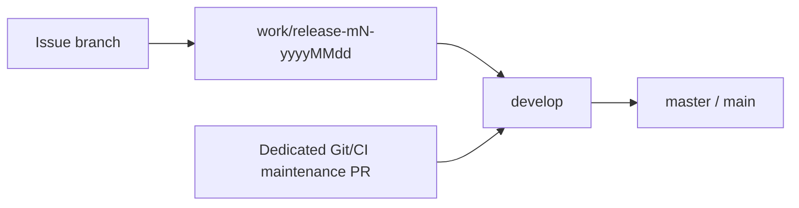

# Git process

Merge-method follow-up: [#106](https://github.com/tuanvipandpro/QuizMos/issues/106). Tracking: [#97](https://github.com/tuanvipandpro/quiz-app/issues/97). This is the canonical branch/routing policy. See [contributing](contributing.md) for change classification, verification, secrets and release acceptance.

## Branch routing

| Target                                        | Source                                            | Purpose                                                                    |
| --------------------------------------------- | ------------------------------------------------- | -------------------------------------------------------------------------- |
| `master` (or `main` after an explicit rename) | **`develop` in this same repository only**        | Accepted production promotion                                              |
| `develop`                                     | Accepted milestone release                        | Integrate a completed milestone                                            |
| `develop`                                     | Dedicated repository-governance/CI maintenance PR | Bootstrap or maintain this process; keep separate from product feature MRs |
| `work/release-mN-yyyyMMdd`                    | Issue branch based on that release                | One cohesive issue's implementation                                        |
| Existing milestone release                    | `develop` through an explicit baseline-sync PR    | Bring accepted governance/hotfix baseline into an already-created release  |



The production branch is currently `master`; do not create or rename it to `main` implicitly. A fork branch named `develop`, a milestone release, a feature branch or a direct hotfix branch is not an accepted production PR source. Bring fixes through `develop` before production promotion. Repository identity uses both the repository name and immutable ID.

GitHub branch protection does not prevent someone opening a wrong-source PR. The required `pr-source-policy` check rejects its merge and handles base edits, so acceptance from an earlier integration target is reevaluated. This ordinary PR check is read-only, has a unique job name and never creates a skipped push-event success.

PR head code can edit its own ordinary workflow, so production also has a trusted routing guard. Its `pull_request_target` workflow checks out exactly the protected base SHA, installs no dependencies and never checks out or executes head code. It refreshes current PR metadata before deciding, so a queued event does not close a PR already moved to an integration base. With only read-content/pull-request-state permission, it closes the exact wrong-source production PR; valid same-repository develop PRs cause no API mutation. It never publishes commit-scoped verdicts that could conflate different PRs sharing a head SHA. API failure or an already-merged response is reported as enforcement failure, not successful closure. This guard becomes active when the governance workflow reaches production through the permitted develop promotion. No provider secret, production data or inference is used. CI/policy changes still require review; administrators retain the ability to edit repository settings.

## Branches and milestones

1. Update the protected `develop` baseline through accepted PRs. Create a release from its current commit, named `work/release-mN-yyyyMMdd`: positive milestone number and real calendar date in Asia/Saigon. Current M1 is `work/release-m1-20261106`; M2/M3 get their own dated branches.
2. Start each issue branch from that release. Use descriptive `codex/` names including the issue number where practical, for example `codex/80-exam-history`. Existing M1 branch names remain valid; do not rewrite working history merely to rename them.
3. Target issue PRs at their milestone release. Keep one cohesive issue per MR. Preserve stable data IDs, account isolation and the issue's independent acceptance/rollout gates while resolving shared code changes.
4. When the milestone is accepted, open release → `develop`, then `develop` → production PRs. Follow the merge-method matrix below; preserve each issue commit through milestone and production promotion. Do not squash/reset shared development history or force-push protected branches.

## Merge methods

One issue produces one implementation PR and one final squash commit in develop. Working branches may contain multiple commits; WIP/debug commits must not reach develop separately. Include both the issue and original PR number in the squash subject, for example `feat(history): archive exams (Refs #80) (#92)`. Review the final squash message rather than copying the complete WIP log. A follow-up after accepted integration gets a new linked issue/PR; do not amend protected history to force it into the old commit.

| PR purpose                  | Source → target                  | Method                                                                                                                | Result                                                                            |
| --------------------------- | -------------------------------- | --------------------------------------------------------------------------------------------------------------------- | --------------------------------------------------------------------------------- |
| Issue implementation        | Issue branch → milestone release | **Squash and merge**                                                                                                  | Exactly one traceable commit for that issue                                       |
| Repository governance issue | Issue branch → develop           | **Squash and merge**                                                                                                  | One commit for the governance issue                                               |
| Milestone integration       | Accepted release → develop       | Preserve issue commits; fast-forward only when available through the protected PR process, otherwise **merge commit** | Each issue stays one commit; an optional milestone merge commit records promotion |
| Production release          | Same-repository develop → master | **Merge commit**, one PR per milestone                                                                                | One release PR with milestone notes; shared ancestry is retained                  |
| Accepted baseline sync      | Develop → an existing release    | **Merge commit**                                                                                                      | Preserve shared ancestry without resquashing delivered issues                     |

Do not squash a whole milestone into develop: that would hide the individual issue commits. Do not rebase-and-merge an issue containing several WIP commits: that would retain several commits for one issue. Do not squash shared develop history into master; one release PR does not require collapsing its issue ancestry.

Fast-forward only advances a branch pointer when the target is an ancestor of the source. It neither combines commits nor creates a merge commit. GitHub's standard PR merge choices do not provide a native fast-forward-only button. Keep protected PR/CI requirements: never replace a checked PR with a direct push merely to obtain a linear graph. The merge-commit fallback above is the default for GitHub promotions; an additional milestone merge commit does not count as a second issue implementation commit.

## Branch cleanup

Retain an issue branch after its squash into a release. Delete its remote branch only after the recorded issue squash commit has reached develop and required post-merge develop checks pass. Check the squash commit's ancestry, not the original multi-commit branch head: squashing deliberately changes that relationship. Confirm the branch still has the reviewed head and contains no subsequent unmerged work.

Delete only that issue branch. Never delete develop, master/main, the active milestone release, or an unrelated branch. Keep a small issue/PR-to-squash-commit record in the promotion PR so delayed cleanup is auditable. Local worktree removal is separate; preserve dirty files and do not force-delete a checked-out branch.

Do not enable repository-wide automatic head deletion for this flow: it would remove issue branches immediately after release integration, before they reach develop. Do not pass `--delete-branch` on issue → release merges. This policy specifies controlled cleanup; this change does not install a deletion bot or change GitHub settings.

## Milestone release notes

Use one open develop → master PR for the milestone. Update that PR as the accepted develop head advances rather than opening one production PR per issue. Title it with the milestone, for example `Release M1 — Reliable learning foundation`.

Its body must contain the user-visible features/fixes/data changes grouped by issue/PR, actual verification results and head, configuration/migrations/rollout gates, known incomplete acceptance, and rollback notes. Separate code integration from production activation. Keep issue references as `Refs #N`; close delivery issues only after their required production checks/smoke pass.

## Existing M1 history

The current M1 release already contains issue merge commits made under the earlier policy. It cannot be promoted unchanged while claiming the new one-commit-per-issue layout. Before its final integration, prepare a clean successor release from accepted develop and reconstruct one reviewed commit per issue, retaining original issue/PR references. Compare the complete result with the verified M1 candidate and rerun applicable integration checks. Preserve the original published release for audit; do not force-push it or rewrite protected develop/master history. Existing pre-policy develop commits are historical, not silently rewritten.

## Protection and CI

- Production and `develop` require PRs, up-to-date bases, GitHub Actions `test-and-build`, resolved conversations and administrator enforcement. Force pushes, branch deletion and bypass grants are disabled. Zero independent required approvals permits the single-maintainer workflow; it does not waive PR/check or owner-requested merge requirements.
- Production additionally requires GitHub Actions **`pr-source-policy`**. It accepts only same-repository `develop`. The shared API configuration is [branch-protection.json](../.github/branch-protection.json); [git-process.mjs](../scripts/git-process.mjs) generates the role-specific production payload without duplicating or mutating the develop policy:

  ```sh
  node scripts/git-process.mjs protection master
  node scripts/git-process.mjs protection develop
  ```

- CI validates production, `develop` and dated milestone releases. Its baseline is a successful same-target-branch workflow run from this repository, with Git ancestry validation. Missing or untrusted evidence selects full verification. Prior-base green checks do not prove a moved/updated PR's current integration.
- Only a push to the main/master repository default branch can publish production artifacts, after the existing runtime-diff/component, same-run build, credential and migration gates. Release/develop pushes validate without deploying. PRs never deploy.
- The lightweight source-policy workflow handles `edited` events independently. PR text edits do not restart the heavy pipeline. Refresh full CI by updating the PR head against its target when the integration base changes.

## Issue, commit and MR lifecycle

Create/reuse the tracking issue before implementation and record type, risk and acceptance. Write documentation in English. Use descriptive commit subjects and `Refs #N`; do not use automatic issue-closing keywords. Link issue/PR in both directions. Report the final behavior and actual tests/limitations; keep screenshots/logs/traces ignored or in CI artifacts.

Before push, inspect staged files and all outgoing commits and run the redacted secret scans in [secret handling](contributing.md#credentials-and-secrets). Use the applicable [verification plan](contributing.md#classify-work-and-scale-documentationtests). Wait for required checks on the latest head. Merge only when the owner requests it; never use administrator bypass, weaken checks, fabricate status results or merge a feature because a process change was approved.

A merge into a milestone release is integration. Keep delivery issues open until their accepted scope, production promotion, post-merge CI/deploy and applicable real smoke/rollout checks pass. Firebase publication, history enablement and live AI usage retain their separate authorization and account/budget requirements.

## Current governance bootstrap

The dedicated Git-process MR targets `develop`, retaining the earlier branch-aware CI bootstrap and adding production-source enforcement. The older unmerged release-targeted setup MR is superseded, not delivered or used as permission to merge features.

After the governance MR is accepted into `develop`, synchronize that accepted baseline into the already-created M1 release through a checked baseline-sync PR. Then update the M1 issue heads and verify actual current-base checks. M1 delivery MRs #89–#95 and coordination #88 continue targeting the M1 release; #92 remains draft until #89 is integrated there. No product feature is merged by this bootstrap. Production itself receives the process only via the permitted `develop` promotion.

## Verification and configuration changes

Policy tests cover same-repository production promotion, wrong source branches, forks named develop, missing/mismatched metadata, base changes and immutable role-specific protection. The CLI uses synthetic event files. Trusted-guard tests verify exact-PR closure, same-SHA independence, valid-source zero writes, mismatched-base rejection and API failures through a stub fetch. They close no real PRs. Use local fixtures/emulators for routine application tests; metadata-policy tests need no live account or credential.

When applying branch settings, review the generated payload against current remote settings, preserve unrelated requirements, and verify API readback of the pinned check providers/admin/PR/force/delete controls. Do not silently replace drifted settings. Do not infer enforcement from a dry-run push. Keep policy/routing changes reviewable in their own PR and record actual configuration/CI evidence in the tracking issue.
